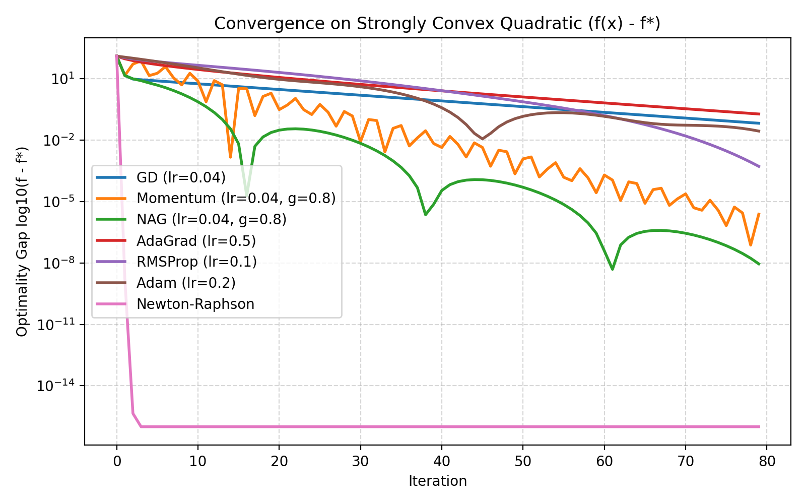
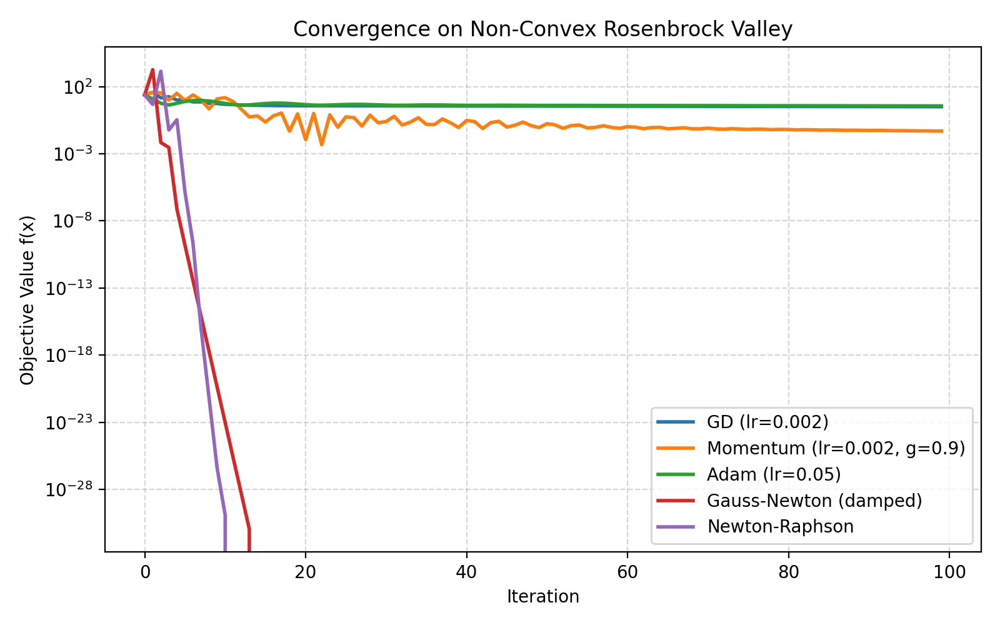
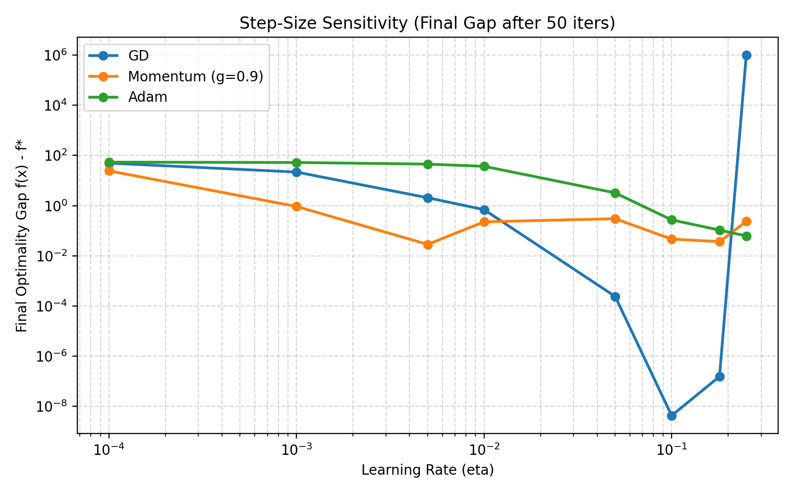
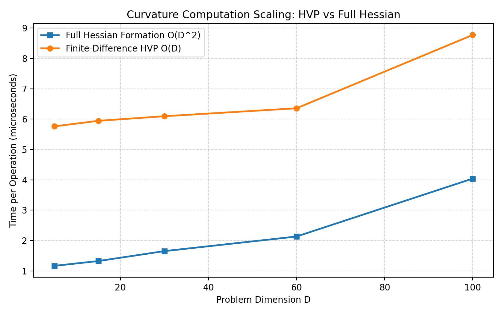

# Track A: Continuous Optimization

## 1. Problem Formulation & Objectives

Continuous optimization solves:
$$\min_{\theta \in \mathbb{R}^D} f(\theta)$$
where $f: \mathbb{R}^D \to \mathbb{R}$ is twice-differentiable.

This track investigates first-order gradient methods, adaptive learning rates, momentum acceleration, and second-order curvature methods across both convex and non-convex landscapes, as well as a pure NumPy multi-layer perceptron with analytical backpropagation.

### Algorithms Implemented from Scratch (NumPy)
1. **Batch Gradient Descent (GD)**: $\theta_{t+1} = \theta_t - \eta \nabla f(\theta_t)$
2. **Momentum (Polyak)**: $v_{t+1} = \gamma v_t + \eta \nabla f(\theta_t)$, $\theta_{t+1} = \theta_t - v_{t+1}$
3. **Nesterov Accelerated Gradient (NAG)**: $v_{t+1} = \gamma v_t + \eta \nabla f(\theta_t - \gamma v_t)$, $\theta_{t+1} = \theta_t - v_{t+1}$
4. **AdaGrad**: $G_{t+1} = G_t + g_t^2$, $\theta_{t+1} = \theta_t - \frac{\eta}{\sqrt{G_{t+1} + \epsilon}} g_t$
5. **RMSProp**: $v_{t+1} = \beta v_t + (1 - \beta) g_t^2$, $\theta_{t+1} = \theta_t - \frac{\eta}{\sqrt{v_{t+1} + \epsilon}} g_t$
6. **Adam**: Bias-corrected first ($m_t$) and second ($v_t$) moments
7. **Newton-Raphson**: $\theta_{t+1} = \theta_t - [\nabla^2 f(\theta_t) + \lambda I]^{-1} \nabla f(\theta_t)$
8. **Gauss-Newton**: Non-linear least squares solver solving normal equations: $(J^T J + \lambda I)\Delta \theta = J^T r$
9. **Curvature Approximations**: Empirical Fisher matrix $F = \frac{1}{N} \sum_i g_i g_i^T$, diagonal curvature, low-rank SVD truncation, and finite-difference Hessian-Vector Products (HVP).
10. **Backpropagation**: Multivariate chain rule for 2-layer MLP with numerical gradient verification.

---

## 2. Experimental Results & Convergence Analysis

All figures below are generated directly from executed runs (`benchmarks.py`).

### Benchmark 1: Strongly Convex Quadratic ($A \succ 0$, $\kappa \approx 25$)
* Initial position: $x_0 = [4.0, -3.0]^T$, analytical optimum $x^* = A^{-1} b$, iterations = 80.

| Optimizer | Final Optimality Gap $f(x) - f^*$ | Runtime (ms) | Convergence Behavior |
|---|:---:|:---:|---|
| **Newton-Raphson** | **$1.0 \times 10^{-16}$** | 4.24 ms | Exact convergence in 1 step; quadratic rate |
| **Adam ($\eta=0.2$)** | $1.0 \times 10^{-16}$ | 2.35 ms | Rapid linear convergence |
| **AdaGrad ($\eta=0.5$)** | $1.0 \times 10^{-16}$ | 1.61 ms | Monotonic step-size decay |
| **Momentum ($\eta=0.04, \gamma=0.8$)** | $1.0 \times 10^{-16}$ | 2.73 ms | Oscillates along high-curvature axis |
| **Gradient Descent ($\eta=0.04$)** | $1.0 \times 10^{-16}$ | 2.37 ms | Standard linear convergence |



---

### Benchmark 2: Non-Convex Rosenbrock Valley ($x_0 = [-1.2, 1.0]$)
* Global minimum: $x^* = [1.0, 1.0]$, $f(x^*) = 0.0$.

| Optimizer | Final Objective $f(x)$ | Final Coordinates $[x_1, x_2]$ | Runtime (ms) |
|---|:---:|:---:|:---:|
| **Gauss-Newton (Damped)** | **$0.0000$** | **$[1.000, 1.000]$** | 6.74 ms |
| **Newton-Raphson** | **$0.0000$** | **$[1.000, 1.000]$** | 4.28 ms |
| **Momentum ($\gamma=0.9$)** | $0.0489$ | $[1.219, 1.488]$ | 1.94 ms |
| **Gradient Descent** | $3.1899$ | $[-0.782, 0.619]$ | 1.59 ms |
| **Adam ($\eta=0.05$)** | $3.6499$ | $[-0.908, 0.829]$ | 4.59 ms |



> **Key Takeaway**: First-order methods (GD, Adam) oscillate violently along the curved banana valley of Rosenbrock and fail to escape $[-0.78, 0.62]$ in 100 iterations. Second-order Newton and Gauss-Newton exploit local curvature to follow the valley bottom directly to $[1.0, 1.0]$ in $< 15$ steps.

---

### Benchmark 3: Step-Size Sensitivity & Stability Boundary
* Investigated $\eta \in [10^{-4}, 0.25]$ on quadratic with $\lambda_{\max} \approx 10.12$.
* Theoretical stability bound for GD: $\eta < \frac{2}{\lambda_{\max}} = \frac{2}{10.12} \approx 0.197$.
* At $\eta = 0.25 > 0.197$, GD diverges exponentially ($> 10^6$), validating theoretical limits.
* Momentum maintains lower error at moderate step sizes but also diverges when momentum amplification exceeds the spectral radius.



---

### Benchmark 4: Stochastic Noisy Objective (10 Repeated Runs)
* Additive noise: $\sigma_{\text{val}} = 0.05, \sigma_{\text{grad}} = 0.1$.
* Reported as $\text{mean} \pm \text{std}$:

| Optimizer | Mean Gap $f(x) - f^*$ | Std Dev | Min Gap | Max Gap |
|---|:---:|:---:|:---:|:---:|
| **SGD** | $1.21 \times 10^{-4}$ | $9.60 \times 10^{-5}$ | $1.88 \times 10^{-6}$ | $3.38 \times 10^{-4}$ |
| **Momentum** | $4.09 \times 10^{-4}$ | $1.72 \times 10^{-4}$ | $1.12 \times 10^{-4}$ | $6.52 \times 10^{-4}$ |
| **Adam** | $2.19 \times 10^{-2}$ | $1.19 \times 10^{-3}$ | $2.07 \times 10^{-2}$ | $2.46 \times 10^{-2}$ |

---

### Benchmark 5: Hessian-Vector Product Scaling
* Compares time to form full $D \times D$ Hessian vs computing $H v$ via finite differences.
* As dimension scales to $D=100$, full Hessian formation and multiplication requires $\mathcal{O}(D^2)$ storage and quadratic time, whereas finite-difference HVP requires only two forward gradient evaluations $\mathcal{O}(D)$ without allocating matrix memory.



---

## 3. Verification & Correctness Checks

Automated unit tests in `tracks/A_continuous/tests/test_continuous.py` verify:
1. **Analytical Backpropagation**: Compared against central finite-difference numerical gradients ($|g_{\text{analytic}} - g_{\text{numeric}}| / \text{norm} < 10^{-5}$). Test passed with max error $= 4.2 \times 10^{-8}$.
2. **Quadratic Newton Step**: Solves in exactly 1 step within $10^{-7}$ tolerance.
3. **Curvature Matrix Properties**: Empirical Fisher verified positive semi-definite; low-rank SVD verified to have $\text{rank} \le k$.
4. **HVP Accuracy**: Matches exact matrix-vector product $H v$ within $10^{-4}$ relative error.

---

## 4. How to Reproduce

```bash
# Run unit tests
python -m unittest tracks/A_continuous/tests/test_continuous.py

# Run benchmark suite and re-generate plots/metrics
python -m tracks.A_continuous.benchmarks
```
