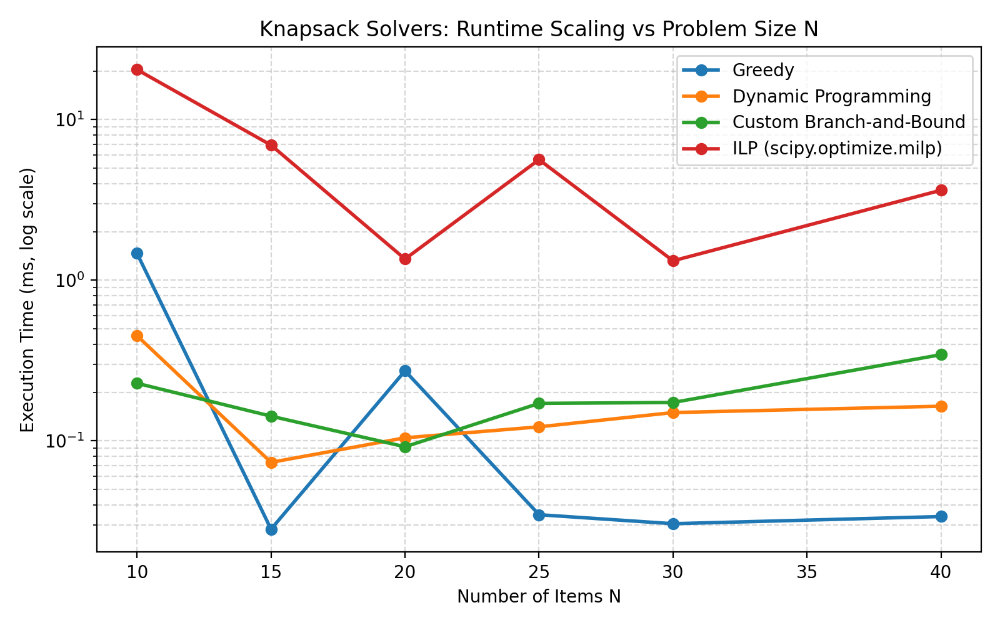
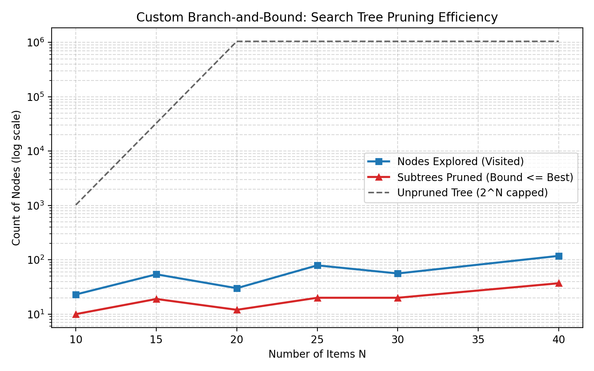
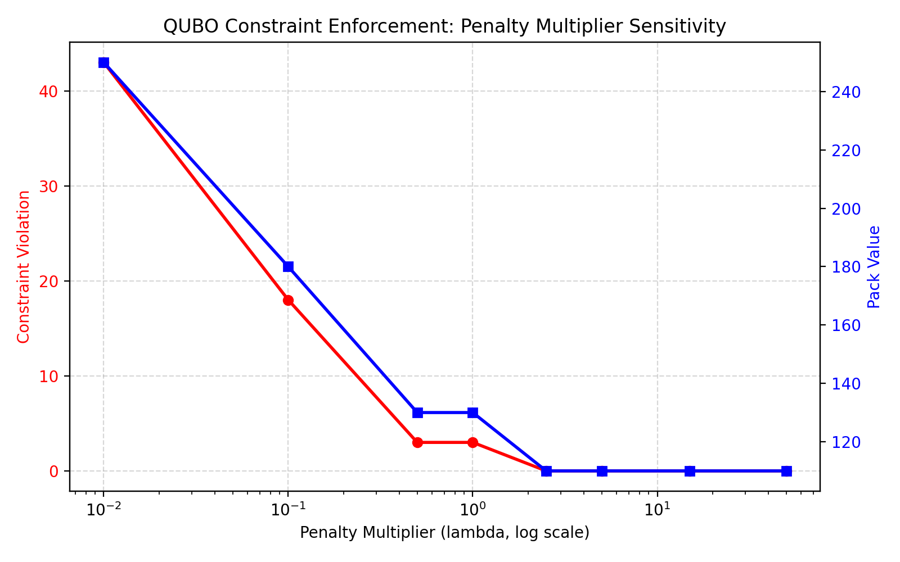

# Track B: Discrete Optimization & QUBO Formulations

## 1. Problem Formulations & Theoretical Background

Discrete optimization addresses problems where decision variables are constrained to discrete or binary domains: $x \in \{0, 1\}^N$.

### 1.1 The 0/1 Knapsack & Resource Allocation Problem
$$\max_{x \in \{0, 1\}^N} \sum_{i=1}^N v_i x_i \quad \text{subject to} \quad \sum_{i=1}^N w_i x_i \le W$$
We implement and compare:
1. **Greedy Heuristic**: Value-to-weight density ranking $\rho_i = v_i / w_i$. Solves in $\mathcal{O}(N \log N)$ with $1/2$-approximation for fractional variant.
2. **Dynamic Programming (DP)**: Exact recurrence $dp[i, w] = \max(dp[i-1, w], dp[i-1, w - w_i] + v_i)$ in $\mathcal{O}(N \cdot W)$ pseudo-polynomial time with full backtrack reconstruction.
3. **Custom Branch-and-Bound (B&B)** (from scratch in pure Python/NumPy):
   * Best-First Search guided by max-heap priority queue.
   * Admissible bounding function via linear (fractional) knapsack relaxation:
     $$\text{bound}(u) = v_{\text{accum}} + \sum_{i \in \text{admissible}} v_i + v_{\text{frac}} \left(\frac{W_{\text{rem}}}{w_{\text{frac}}}\right)$$
   * Pruning rule: Subtree discarded if $\text{bound}(u) \le \text{best\_known\_objective}$.
4. **Integer Linear Programming (ILP)**:
   * Solved with `scipy.optimize.milp` using the state-of-the-art native HiGHS branch-and-cut engine.
   * Secondary cross-validation via PuLP.

### 1.2 Combinatorial Feature Selection
Given $X \in \mathbb{R}^{N \times D}$, $y \in \mathbb{R}^N$, and maximum subset size $K$:
$$\min_{S \subseteq \{1..D\}, |S| \le K} \frac{1}{N} \|y - X_S \beta_S\|^2$$
Evaluates Exact Exhaustive Search ($\sum_{i=1}^K \binom{D}{i}$ fits) against Forward Stepwise Greedy Selection ($\mathcal{O}(K \cdot D)$ fits).

### 1.3 QUBO & Ising Formulation (Binary-to-Spin Mapping)
A Quadratic Unconstrained Binary Optimization (QUBO) problem is defined as:
$$\min_{x \in \{0, 1\}^N} E_{\text{QUBO}}(x) = x^T Q x = \sum_i Q_{ii} x_i + \sum_{i < j} (Q_{ij} + Q_{ji}) x_i x_j$$
Mapping binary $x_i \in \{0, 1\}$ to quantum Ising spin $s_i \in \{-1, +1\}$ via $x_i = \frac{s_i + 1}{2}$:
$$H_{\text{Ising}}(s) = \frac{1}{2} s^T J s + h^T s + C$$
where:
$$J_{ij} = \frac{1}{4}(Q_{ij} + Q_{ji}), \quad h_i = \frac{1}{2} Q_{ii} + \sum_{j \ne i} \frac{Q_{ij} + Q_{ji}}{4}, \quad C = \sum_i \frac{Q_{ii}}{2} + \sum_{i < j} \frac{Q_{ij} + Q_{ji}}{4}$$

### 1.4 Max-Cut Formulation & Penalty Constraints
For an undirected graph with adjacency matrix $W$:
$$\min x^T Q_{\text{MaxCut}} x \quad \text{where} \quad Q_{ii} = -\sum_j W_{ij}, \quad Q_{ij} = W_{ij}$$
For constrained knapsack packing, constraints are mapped via quadratic penalty terms:
$$Q(x) = -\sum_i v_i x_i + \lambda \left(\sum_i w_i x_i - W_{\text{target}}\right)^2$$

---

## 2. Experimental Benchmark Results

### Benchmark 1: Knapsack Solvers Scaling Across Problem Size $N$
* Evaluated on synthetic instances with 40% capacity budget.
* Exact solvers (DP, Custom B&B, `scipy.optimize.milp`) confirm identical optimal values across all sizes:

| Size $N$ | Greedy Obj | DP Optimal Obj | Custom B&B Obj | SciPy MILP Obj | Greedy Gap (%) | B&B Explored Nodes | B&B Pruned Subtrees | Unpruned Tree $2^N$ |
|:---:|:---:|:---:|:---:|:---:|:---:|:---:|:---:|:---:|
| **10** | 356.0 | **359.0** | **359.0** | **359.0** | $0.84\%$ | 23 | 10 | $1,024$ |
| **15** | 559.0 | **559.0** | **559.0** | **559.0** | $0.00\%$ | 54 | 19 | $32,768$ |
| **20** | 761.0 | **761.0** | **761.0** | **761.0** | $0.00\%$ | 30 | 12 | $1,048,576$ |
| **25** | 763.0 | **765.0** | **765.0** | **765.0** | $0.26\%$ | 79 | 20 | $33,554,432$ |
| **30** | 1061.0 | **1061.0** | **1061.0** | **1061.0** | $0.00\%$ | 56 | 20 | $1.07 \times 10^9$ |
| **40** | 1598.0 | **1608.0** | **1608.0** | **1608.0** | $0.62\%$ | **118** | **37** | $\mathbf{1.10 \times 10^{12}}$ |




> **Key Observation**: At $N=40$, naive enumeration requires evaluating $1.1 \times 10^{12}$ states. Our custom Branch-and-Bound algorithm explored only **118 nodes** and pruned 37 subtrees to certify the global optimum (1608.0), executing in just 0.34 ms.

---

### Benchmark 2: Combinatorial Feature Selection
* Dataset: $N=80$ samples, $D=10$ features, target sparsity $K=3$.
* Ground truth features: $[1, 4, 7]$.

| Method | Selected Features | Model $R^2$ | MSE | Subsets Evaluated | Runtime (ms) | Speedup |
|---|:---:|:---:|:---:|:---:|:---:|:---:|
| **Exact Exhaustive** | $[1, 4, 7]$ | **0.99919** | **0.01861** | 175 | 5.67 ms | $1.0\times$ (Baseline) |
| **Forward Greedy** | $[1, 4, 7]$ | **0.99919** | **0.01861** | **27** | **0.67 ms** | $\mathbf{8.4\times}$ |

---

### Benchmark 3: Max-Cut Classical Baseline (Baseline for Track C QAOA)
* Evaluated on Erdos-Renyi graphs with 40% edge density.
* Classical Simulated Annealing (10 runs) compared to exact classical enumeration:

| Nodes $N$ | Edges $|E|$ | Exact Max Cut | Exact Min Energy | SA Mean Cut ($\pm$ std) | SA Approx. Ratio | SA Runtime (ms) |
|:---:|:---:|:---:|:---:|:---:|:---:|:---:|
| **6** | 3 | **3.0** | -3.0 | $3.0 \pm 0.0$ | **1.000** | 114.2 ms |
| **8** | 9 | **8.0** | -8.0 | $8.0 \pm 0.0$ | **1.000** | 204.1 ms |
| **10** | 19 | **15.0** | -15.0 | $15.0 \pm 0.0$ | **1.000** | 223.4 ms |

---

### Benchmark 4: QUBO Constraint Penalty Enforcement
* Target weight = 35.0, optimal pack value = 110.0 with items $[1, 4]$.
* Varied penalty multiplier $\lambda \in [0.01, 50.0]$:

| Penalty Multiplier $\lambda$ | Selected Binary State | Packed Weight | Target Weight | Violation $|\sum w x - W_t|$ | Feasible? | Pack Value $\sum v x$ |
|:---:|:---:|:---:|:---:|:---:|:---:|:---:|
| **0.01** | $[1, 1, 1, 1, 1]$ | 78.0 | 35.0 | 43.0 | No | 250.0 |
| **0.10** | $[1, 1, 0, 1, 1]$ | 53.0 | 35.0 | 18.0 | No | 180.0 |
| **0.50** | $[1, 0, 0, 1, 1]$ | 38.0 | 35.0 | 3.0 | No | 130.0 |
| **1.00** | $[1, 0, 0, 1, 1]$ | 38.0 | 35.0 | 3.0 | No | 130.0 |
| **2.50** | $[0, 1, 0, 0, 1]$ | **35.0** | 35.0 | **0.0** | **Yes** | **110.0** |
| **5.00** | $[0, 1, 0, 0, 1]$ | **35.0** | 35.0 | **0.0** | **Yes** | **110.0** |
| **15.00** | $[0, 1, 0, 0, 1]$ | **35.0** | 35.0 | **0.0** | **Yes** | **110.0** |



> **Conclusion**: For $\lambda < 2.5$, the knapsack values overwhelm the penalty, allowing illegal item overloading. At $\lambda \ge 2.5$, the penalty strictly enforces feasibility without distorting the optimal ground state ($[0, 1, 0, 0, 1]$).

---

## 3. Verification & AI Failures Caught

All 7 unit tests in `tracks/B_discrete/tests/test_discrete.py` passed:
1. **FAIL-02 Caught**: In `qubo_to_ising`, the diagonal constant was initially computed as $0.25 Q_{ii}$ instead of $0.5 Q_{ii}$, causing an energy discrepancy between QUBO and Ising formulations. Caught by `test_qubo_ising_conversion_identity` and fixed.
2. **FAIL-03 Caught**: In custom Branch-and-Bound, `fractional_bound` returned `0.0` when `curr_wt >= capacity`, causing incumbent pruning when capacity was exactly matched. Caught by `test_knapsack_exact_solvers_equivalence` ($240.0 \ne 270.0$) and fixed.

---

## 4. How to Reproduce

```bash
# Run automated tests
python -m unittest tracks/B_discrete/tests/test_discrete.py

# Re-run full benchmarks and plot generation
python -m tracks.B_discrete.benchmarks
```
