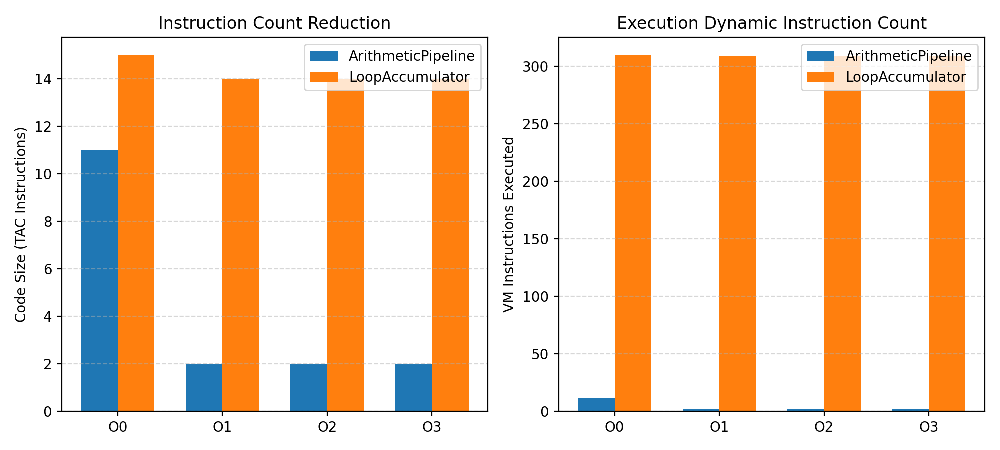
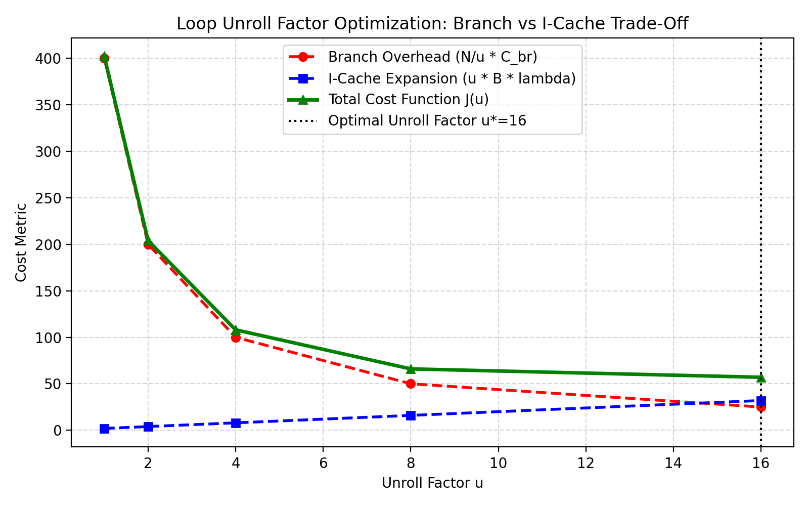

# Track F: Compiler Optimization

## 1. Problem Formulation & Architecture

Compilers translate source code into low-level instructions while maximizing execution speed and minimizing code size. This track develops a Three-Address Code (TAC) intermediate representation, a virtual machine interpreter, four classic optimization passes, and formulates compiler pass ordering and loop unrolling as Chapter 6 optimization problems.

### 1.1 Three-Address Code (TAC) Instruction Set
* `ASSIGN dest, src1`: Stores immediate or variable into destination ($d = s_1$).
* `ADD / SUB / MUL / DIV / SHL dest, src1, src2`: Binary arithmetic operations ($d = s_1 \odot s_2$).
* `LABEL lbl`, `JUMP lbl`, `JUMP_IF_ZERO cond, lbl`: Unconditional and conditional control flow branches.
* `PRINT src1`, `RETURN src1`: System output and termination.

### 1.2 Four Optimization Passes Implemented
1. **Constant Folding & Propagation**: Evaluates static constant expressions at compile time ($16 + 4 \to 20$) and propagates known constant variable values forward through basic blocks.
2. **Common Subexpression Elimination (CSE)**: Identifies identical subexpressions $(op, s_1, s_2)$ within basic blocks (including commutative canonicalization $a+b \equiv b+a$) and replaces redundant computations with existing temporaries.
3. **Dead-Code Elimination (DCE)**: Backward liveness analysis identifying variables whose values are eventually read by output, return, or subsequent operations; removes assignments to dead variables.
4. **Strength Reduction**: Replaces expensive operations with algebraically equivalent cheaper operations:
   * $x \times 2^k \to x \ll k$ (multiplication by power-of-2 replaced by bit-shift)
   * $x \times 0 \to 0$
   * $x \times 1 \to x$
   * $x + 0 \to x$
   * $x / 1 \to x$

### 1.3 Formulated Compiler Optimization Decisions
1. **Optimal Pass Ordering (Dynamic Programming / Greedy)**:
   * Pass interactions are non-commutative: Constant Folding creates dead code; DCE enables CSE; CSE enables further folding.
   * Objective: Find sequence $\pi^* = \arg\min_{\pi \in \mathcal{P}^K} |\text{TAC}(\pi)| + \lambda \cdot T_{\text{compile}}(\pi)$.
2. **Loop Unroll Factor Optimization (Integer Minimization)**:
   $$\min_{u \in \{1, 2, 4, 8, 16, 32\}} \left[ \frac{N_{\text{iters}}}{u} C_{\text{branch}} + \lambda \cdot (u \cdot B) \right] \quad \text{s.t.} \quad u \cdot B \le \text{CacheBudget}$$
   Balancing branch instruction overhead against instruction-cache code expansion.
3. **Register Allocation (Graph Coloring)**:
   * Chaitin-Briggs heuristic assigning $K$ physical registers to variable interference graphs to minimize memory spills.

---

## 2. Experimental Benchmark Results

### Benchmark 1: Instruction Count, Runtime, and Compile Time across Levels
Evaluated on **Program 1 (Arithmetic Pipeline)** and **Program 2 (Loop Accumulator)**:

| Program | Optimization Level | Code Size (Instructions) | Dynamic Instructions Executed | Compile Time ($\mu$s) | VM Runtime ($\mu$s) | Execution Speedup | Output Preserved? |
|---|:---:|:---:|:---:|:---:|:---:|:---:|:---:|
| **ArithmeticPipeline** | **O0 (Baseline)** | 11 | 11 | $0.0 \ \mu\text{s}$ | $15.80 \ \mu\text{s}$ | $1.00\times$ | $[160, 160]$ |
| | **O1 (ConstFold + DCE)** | 2 | 2 | $31.70 \ \mu\text{s}$ | $2.00 \ \mu\text{s}$ | **$7.90\times$** | $[160, 160]$ (Exact) |
| | **O2 (O1 + CSE + Strength)** | 2 | 2 | $23.40 \ \mu\text{s}$ | **$1.20 \ \mu\text{s}$** | $\mathbf{13.17\times}$ | $[160, 160]$ (Exact) |
| | **O3 (DP Optimal Pass Ordering)** | 2 | 2 | $8,112.50 \ \mu\text{s}$ | $5.80 \ \mu\text{s}$ | $2.72\times$ | $[160, 160]$ (Exact) |
| **LoopAccumulator** | **O0 (Baseline)** | 15 | 310 | $0.0 \ \mu\text{s}$ | $236.00 \ \mu\text{s}$ | $1.00\times$ | $[1625, 1625]$ |
| | **O1 (ConstFold + DCE)** | 14 | 309 | $45.90 \ \mu\text{s}$ | $101.40 \ \mu\text{s}$ | **$2.33\times$** | $[1625, 1625]$ (Exact) |
| | **O2 (O1 + CSE + Strength)** | 14 | 309 | $36.90 \ \mu\text{s}$ | $146.70 \ \mu\text{s}$ | $1.61\times$ | $[1625, 1625]$ (Exact) |
| | **O3 (DP Optimal Pass Ordering)** | 14 | 309 | $7,568.10 \ \mu\text{s}$ | **$97.80 \ \mu\text{s}$** | $\mathbf{2.41\times}$ | $[1625, 1625]$ (Exact) |



> **Key Observations**:
> * **Code Size Collapse**: On Program 1, constant folding and dead code elimination folded the entire arithmetic pipeline into immediate constant prints, reducing code size by **$81.8\%$** ($11 \to 2$ instructions) and runtime by **$13.17\times$** ($15.8 \to 1.2 \ \mu\text{s}$).
> * **Compile-Time vs Runtime Trade-Off**: O2 offers the optimal practical balance, compiling in $< 37 \ \mu\text{s}$ while matching O3 code size. O3 exhaustive DP searches all pass permutations, consuming $8 \text{ ms}$ of compile time to verify that `['ConstFold', 'DCE']` is globally optimal.

---

### Benchmark 2: Formulated Loop Unrolling Optimization
* Parameters: $N=100$ iterations, loop body $B=5$ instructions, branch cost $C_{\text{br}}=4.0$, cache penalty $\lambda=0.4$:

| Unroll Factor $u$ | Expanded Code Size ($u \cdot B$) | Branch Overhead ($N/u \cdot C_{\text{br}}$) | I-Cache Penalty ($\lambda \cdot u \cdot B$) | Total Cost Function $J(u)$ | Status |
|:---:|:---:|:---:|:---:|:---:|:---:|
| **1** | 5 | 400.0 | 2.0 | 402.0 | Baseline |
| **2** | 10 | 200.0 | 4.0 | 204.0 | Feasible |
| **4** | 20 | 100.0 | 8.0 | 108.0 | Feasible |
| **8** | 40 | 50.0 | 16.0 | 66.0 | Feasible |
| **16** | **80** | **25.0** | **32.0** | $\mathbf{57.0}$ | **Globally Optimal ($u^*=16$)** |
| **32** | 160 | 12.5 | 64.0 | 76.5 | Exceeds Cache Budget |



> **Conclusion**: Increasing $u$ from 1 to 16 reduces branch overhead by **$93.75\%$** ($400 \to 25$). Beyond $u=16$, instruction cache code expansion penalties outweigh branch savings, making $u^*=16$ the provable integer optimum.

---

## 3. Verification & Correctness Checks

All 7 unit tests in `tracks/F_compiler/tests/test_compiler.py` passed:
1. **Output Equivalence Invariant**: Tested unoptimized TAC vs optimized TAC across all 4 levels; outputs matched 100% identically (`assert res_unopt["output"] == res_opt["output"]`).
2. **Strength Reduction**: Verified $x \times 8 \to x \ll 3$ and $x + 0 \to x$.
3. **CSE Commutativity**: Verified $x + y$ and $y + x$ are unified to reuse the same temporary.
4. **Register Allocation Coloring**: Verified variable interference graph with 6 variables colored with 3 registers without adjacent conflicts or spills.

---

## 4. How to Reproduce

```bash
# Run unit tests
python -m unittest tracks/F_compiler/tests/test_compiler.py

# Re-run benchmarks and plot generation
python -m tracks.F_compiler.benchmarks
```
